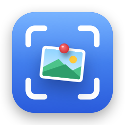
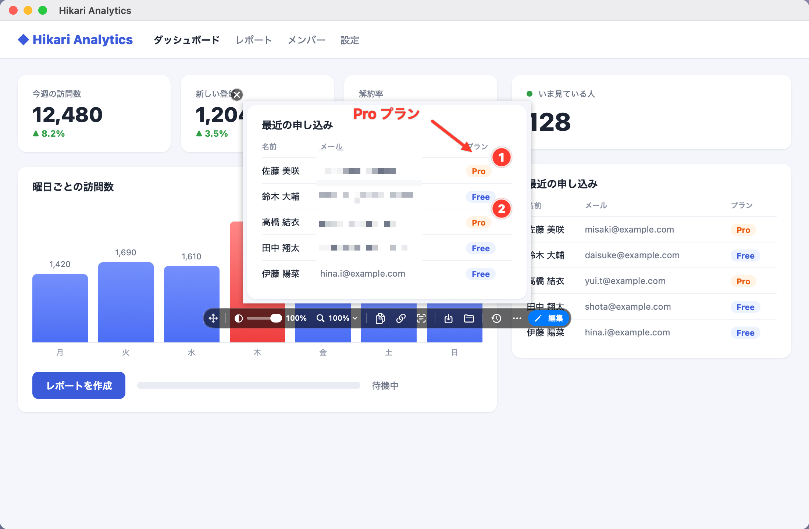
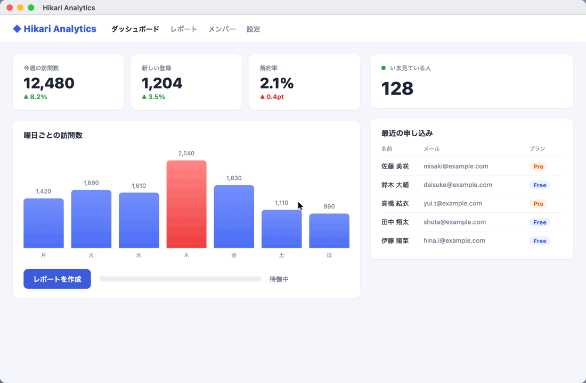
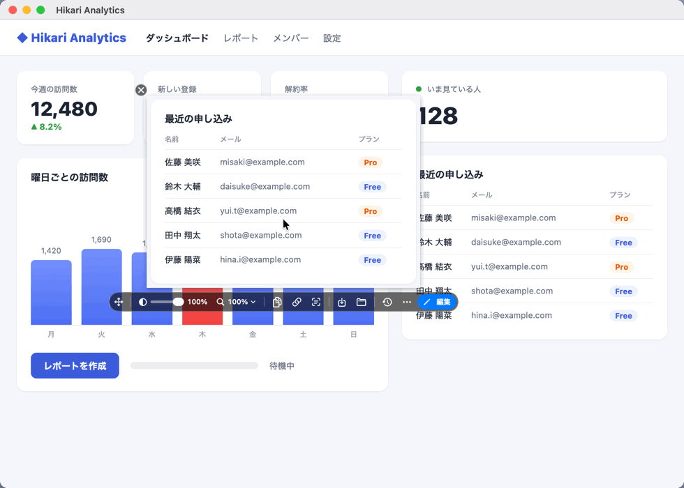

<p align="center">
  
</p>

<h1 align="center">Pinshot</h1>

<p align="center">
  画面をキャプチャして、そのまま最前面に浮かべておける macOS のメニューバーアプリ
</p>

<p align="center">
  <a href="LICENSE"></a>
  
  
</p>

<p align="center">
  
</p>

> [!NOTE]
> **いまは β 版です。** 思わぬ不具合があるかもしれません。見つけたら [Issues](https://github.com/nexy-apps/pinshot/issues) で教えてください。操作や設定の保存形式は、正式版までに変わることがあります。

> **English:** Pinshot is a macOS menu bar app that captures part of your screen and keeps it floating above other windows. You can annotate the floating image with arrows, text, numbered markers, mosaic, and more, then copy or save it. The UI is currently in Japanese.

## 使い方

1. **撮る**：`⌘⇧2` を押して、撮りたい範囲をドラッグします（`space` でウィンドウを撮るモードに切り替わります）。撮った画像は、その場に最前面で浮かびます。ドラッグで好きな場所へ動かせます

   <p align="center">
     
   </p>

2. **書き込む**：画像をダブルクリックするか、画像の下の操作バーの「編集」で編集モードに入ります。番号・モザイク・文字マーカー・四角・矢印・文字などを重ねられます

   <p align="center">
     
   </p>

3. **書き出す**：`⌘C` でコピー、`⌘S` で保存します。`⌥` を押しながらドラッグすると、ほかのアプリや Finder に直接ドロップできます。ツールバーの「背景」で、余白・背景・角丸・影を付けた見た目にもできます
4. **録画する**：`⌘⇧2` のあと、画面の下のバーで「録画」を選んで範囲をドラッグします。止めると録画がその場に浮かんで再生され、MP4 か GIF で保存できます

   <p align="center">
     
   </p>

> いちばん上の画像とこの節の動きは、Pinshot と同じ部品を実際に動かし、見本の画面の上に描き写して作っています（`make readme-images` で作り直せます）。

## できること

- **キャプチャ**：範囲・ウィンドウ・画面全体・タイマー。グローバルショートカット（初期設定は `⌘⇧2`）で始められます
- **画面の録画**：範囲・ウィンドウ・画面全体を録画し、浮かせてその場で再生できます。MP4 か GIF で保存・コピーできます（最長 10 分）。音は「音なし・Mac の音・マイクの音・Mac の音＋マイクの音」から選べます（GIF には音は入りません）
- **最前面に浮かべる**：撮った画像はその場に浮かび、ほかのアプリを使っている間も見えたままです。拡大縮小・不透明度も変えられます。終了・再起動しても、書き込みごと元の場所に戻ります
- **書き込み**：四角・楕円・矢印・ペン・蛍光ペン・文字マーカー（画像の文字に合わせて蛍光ペン・下線・取り消し線・囲み）・文字・番号・スポットライト・モザイク・ぼかし・トリミング。元に戻す・やり直す、スタイルの保存もできます
- **書き出し**：コピー・PNG で保存・ドラッグ＆ドロップ。余白・背景色・角丸・影を付けた見た目でも書き出せます
- **文字の読み取り**：浮かせた画像の文字を読み取ってコピーできます（全体か、ドラッグで選んだ範囲。日本語と英語。Mac の中で読み、ネットには送りません）。読み取った文字は吹き出しで見られ、直してからコピーし直すこともできます
- **共有リンク**：浮かせた画像を Gyazo に上げて、リンクをクリップボードに入れます（ページの URL・画像の URL・Markdown から選べます）。Slack・Discord・GitHub などに貼ると、その場で画像が出ます。撮ったら自動で上げることもできます（初期設定はオフ）。録画は GIF にして上げられます
- **履歴**：撮った画像と読み取った文字を、日付ごとに一覧で見られます。画像はもう一度浮かせたり、コピー・保存したり、文字はもう一度コピーしたりできます（残す期間と数は設定で選べます）。上げたもの（共有リンク）も一覧で見て、リンクのコピーや削除ができます
- **複数のディスプレイ**にも対応しています
- **アップデート**：新しい版を 1 時間に 1 回確かめ、メニューバーのアイコンの印（右下の下向きの矢印）とメニューで知らせます（画面には割り込みません）。メニューから、そのまま更新できます。更新しても、画面収録などの許可は取り直さずに使えます

くわしい操作は [docs/USAGE.md](docs/USAGE.md) を見てください。

## ダウンロード

[Releases](https://github.com/nexy-apps/pinshot/releases) から `Pinshot-<版>.dmg` をダウンロードして開き、`Pinshot` を `Applications`（アプリケーションフォルダ）へドラッグしてください（`.zip` もあります。展開して `Pinshot.app` を入れる形で、中身は同じです）。Intel と Apple Silicon のどちらの Mac でも動きます。

**本物の Pinshot は、この [Releases](https://github.com/nexy-apps/pinshot/releases) からだけ配っています。** ほかの場所で配られているものは、作者が作ったものではありません。

作者が自分で作った証明書（nexy Release Signing）で署名していますが、Apple の公証は受けていないので、初めて開くときに macOS に止められます。「"Pinshot.app"は開いていません」「Apple は、"Pinshot.app"に Mac に損害を与えたり、プライバシーを侵害する可能性のあるマルウェアが含まれていないことを検証できませんでした。」と出て、「ゴミ箱に入れる」と「完了」のボタンが並びます（macOS の版によって、文は少し違います）。

次のどちらかで開けます。一度開けば、次からは止められません。

**システム設定から（おすすめ）**

1. 「完了」を押す（「ゴミ箱に入れる」は押さない。押すと、アプリがゴミ箱に移ります）
2. システム設定 →「プライバシーとセキュリティ」を開き、下のほうへスクロールする
3. 「"Pinshot.app"は開いていません…」の横の「このまま開く」を押す
4. パスワードか Touch ID で確かめたら、もう一度 Pinshot を開く

macOS 14 では、Pinshot を右クリック（control + クリック）して「開く」を選んでも開けます。

**ターミナルから**

1. 「完了」を押す
2. ターミナルで次を流す

   ```bash
   xattr -dr com.apple.quarantine /Applications/Pinshot.app
   ```

3. Pinshot を開く

初めてキャプチャするときに「画面収録」の許可を求められます。システム設定で Pinshot をオンにして、Pinshot を開き直してください。

入れたあとは、アプリの中から新しい版に更新できます（メニューバーのアイコン →「アップデートを確認…」。自動でも確かめます）。更新のときは、「このまま開く」も、許可の取り直しも要りません（どの版も同じ証明書で署名しているので、macOS から同じアプリと見なされます）。

2026-11 に、アプリの ID と署名を変えて、版を 0.1.0 から出し直しました。それより前の β 版（ID `dev.portfolio.pinshot`）からは更新できないので、使っていた場合は、ここから入れ直して、許可を取り直してください（システム設定の一覧で古い Pinshot を「−」で削除してから、もう一度許可します）。履歴と浮かせた画像はそのまま残りますが、設定と Gyazo へのログインは引き継がれません。

## ソースからビルド

自分でビルドする場合の手順です。自分の Mac でビルドしたアプリは、この「開いていません」の画面が出ません。

### 用意するもの

- macOS 14 以降
- Xcode 16 以降（App Store から入れる。コマンドラインツールだけではビルドできません）
- [XcodeGen](https://github.com/yonaskolb/XcodeGen)

### 手順

```bash
brew install xcodegen
git clone https://github.com/nexy-apps/pinshot.git
cd pinshot
make cert
make install
```

最初に 1 回だけ、`make cert` で署名に使う証明書を作ります（途中で Mac のログインパスワードを聞かれます。初めてビルドするときに、codesign が鍵を使ってよいかを聞かれたら「常に許可」を押します）。証明書がないと、`make install` などは止まって案内を出します。証明書を作らずにビルドしたいときは `ADHOC=1` を付けます（アドホック署名。ビルドのたびに、画面収録などの許可を取り直すことになります）。

`make install` は配る版と同じ作り（最適化など）でビルドし、開発のビルドとして `/Applications/Pinshot Dev.app` に入れます（ID は `app.nexy.Pinshot.dev`、画面の名前は「Pinshot Dev」。配る版の Pinshot とは別のアプリとして並び、データも `~/Library/Application Support/Pinshot Dev` に分けて置きます。更新の機能は出ません）。開発中に使う `make run` も同じ場所に置くので、開発版のアプリはいつも 1 つです（システム設定の許可の一覧にも「Pinshot Dev.app」と出るので、配る版の「Pinshot.app」と見分けられます）。Intel と Apple Silicon のどちらの Mac でも動きます。終わったら、アプリケーションフォルダから Pinshot Dev を開いてください。

初めてビルドするときに、更新の仕組み（[Sparkle](https://sparkle-project.org)）の配布物を GitHub から取り寄せて、`Vendor/Sparkle` に置きます（ネットワークが要ります。取り寄せたファイルは、決めてある SHA-256 と合うことを確かめてから使います）。

初めてキャプチャするときに「画面収録」の許可を求められます。システム設定で Pinshot Dev をオンにして、Pinshot Dev を開き直してください。

### 新しい版にする

```bash
cd pinshot
git pull
make install
```

`make install` は、動いている Pinshot Dev を終了してから入れ替えます。いつも同じ証明書で署名するので、画面収録などの許可は外れません。

### 削除

```bash
make uninstall
```

設定・データ・許可は残ります。データもすべて消すときは、`~/Library/Application Support/Pinshot Dev` も削除してください。

## 開発するとき

| コマンド | 内容 |
|---|---|
| `make cert` | 開発用の証明書（`nexy Dev Signing`）を作る（最初に一度だけ。作者以外は `DEV_CERT="〇〇 Dev Signing"` で自分の名前にできる） |
| `make setup` | push の前に自動テストを流す git hooks を有効にする（最初に一度だけ） |
| `make run` | 開発用（Debug。速くビルドできる）にビルドし、動いている Pinshot Dev を終了して、`/Applications/Pinshot Dev.app` に置き換えて起動する（コードを直しては試すときに） |
| `make build` | 開発用にビルドするだけ |
| `make test` | テストを動かす（アプリは起動しない） |
| `make install` | 配る版と同じ設定でビルドし、`make run` と同じ `/Applications/Pinshot Dev.app` に入れる（起動はしない。配る版に近い形で動きを確かめるときに。配る版の Pinshot とは別のアプリとして並ぶ） |
| `make uninstall` | `/Applications/Pinshot Dev.app` を削除する（`make run`・`make install` のどちらで入れたものも。設定・データ・許可は残る） |
| `make dist` | Releases に置く DMG と zip（`dist/Pinshot-<版>.dmg`・`.zip`・`.sha256`）を作る（作者だけ。金庫を開けて、配る版用の証明書で署名する。パスワードを聞かれる） |
| `make publish` | DMG と zip を作り、GitHub に Release（タグ `v<版>`）を作ってアップロードする（作者だけ）。β 版は `make publish BETA=1`（タグ `v<版>-beta.1`・プレリリース）。zip に金庫の中の鍵で署名し、版の一覧（`appcast.xml`）を作って、置き場所（[nexy-apps.github.io](https://github.com/nexy-apps/nexy-apps.github.io)）に送るまで行う（コミット済みで、GitHub の main と同じ状態からだけ動く） |
| `make update-test` | 更新を、手元で通しで試す（別の ID の試験用アプリを 2 つの版で作り、手元のサーバーから配る。[docs/TESTING.md](docs/TESTING.md)） |
| `make update-test-log` | 更新の試験のあいだの macOS の記録を、`build/update-test/system.log` に書き出す（許可が引き継がれたかの裏取りに使う） |
| `make stop` | 動いている Pinshot Dev を終了する（何を止めたかを出す。8 秒たっても終わらなければ強制終了する。配る版の Pinshot は止めない） |
| `make generate` | `Pinshot.xcodeproj` を作るだけ（Xcode で開くとき） |
| `make icon` | アプリのアイコンを描き直す（`scripts/make-app-icon.swift` を変えたとき） |
| `make readme-images` | README の動き（`docs/images` の GIF）を作り直す（`scripts/readme-images/main.swift`。見た目・動きを変えたとき。作っている間、画面に Pinshot の部品が少しのあいだ出る） |

`Pinshot.xcodeproj` は `project.yml` から作るため、リポジトリには入れていません。

### 署名について

macOS は、アプリが同じものかを「アプリの ID ＋ 署名の証明書」で見分け、画面収録などの許可もそれにひも付けて覚えます。証明書なし（アドホック署名）では、ビルドし直すたびに別のアプリと見なされ、許可が外れます。そこで、開発のビルド（`make run`・`make install`・`make update-test`・`make test`）は、`make cert` で作る自分の証明書で署名します（[scripts/create-signing-cert.sh](scripts/create-signing-cert.sh)）。証明書がなければ止まって案内を出し、`ADHOC=1` を付けたときだけアドホック署名にします。

配る版は、作者だけが持つ別の証明書（`nexy Release Signing`）で署名します。この証明書と、更新ファイルの署名の鍵は、ふだんは閉まっている鍵付きのキーチェーン（金庫）に入っていて、`make dist`・`make publish` のときだけ、作者がパスワードで開けます（[scripts/vault.sh](scripts/vault.sh)）。くわしくは [docs/ARCHITECTURE.md](docs/ARCHITECTURE.md) の「署名」を見てください。

許可しているのに案内の画面が出続けるときは、システム設定の画面収録の一覧から古い Pinshot（Pinshot Dev）を「−」で削除し、開き直してから許可し直してください。

## 必要な許可とプライバシー

| 許可 | 使う場面 |
|---|---|
| 画面収録 | 画面を撮るのに必要です。初めてキャプチャするときに求められます |
| アクセシビリティ（任意） | メニューを開いたままショートカットで撮るのに使います。許可しなくても、ほかの使い方はすべてできます |
| マイク（任意） | 録画の音にマイクの音を入れて、自分の声を録るときに使います。初めてマイクの音を入れて録画するときに求められます |

- Pinshot がネットワークに接続するのは、共有リンクを使うときと、新しい版を確かめる・落とすときだけです
  - 共有リンク：設定の「共有」で上げる先（Gyazo）につなぎ、上げる操作をしたとき（自動で上げる設定なら、撮ったとき）に、その画像をあなたの Gyazo のアカウントへ直接送ります。Pinshot の作者のサーバーは通りません。上げる先につないでいなければ、この接続はしません
  - アップデート：GitHub（版の一覧 `https://nexy-apps.github.io/pinshot/appcast.xml` と、Releases の更新ファイル）に接続します。撮った画像・使い方・Mac の情報は送りません（GitHub には、接続元の IP アドレスと、アプリの名前と版が伝わります）。自動の確認は、設定の「一般」→「新しい版を自動で確かめる」で止められます
- 更新ファイルは、作者の鍵（EdDSA）の署名を確かめてから入れます。合わないものは入れません
- Gyazo には、あなたが自分の Gyazo に登録したアプリのアクセストークンでつなぎます。トークンはこの Mac のキーチェーンに保存し、ほかには送りません。上げたものの一覧（リンクと小さな縮小画像）は `~/Library/Application Support/Pinshot/Uploads` に置きます（画像そのものは Gyazo にあり、一覧から外しても Gyazo からは消えません。消すときは「Gyazo からも削除」を選びます）。一覧は新しい 1000 件まで残し、超えた古いものは一覧から外します（Gyazo からは消えません）
- 浮かせている画像と閉じた画像（最大 10 枚）は、終了・再起動のあとも戻せるよう `~/Library/Application Support/Pinshot/Pins` に PNG と状態（書き込み・位置など）で残します。設定の「画像」で戻さないようにすると、すぐ削除します
- 撮った画像は、履歴として `~/Library/Application Support/Pinshot/History` に PNG で残します。読み取った文字も、読み取った範囲の画像と一緒に同じフォルダに残します（初期設定はどちらも 30 日・100 件まで。画像と文字で別々に決められます。期間を過ぎたもの・数を超えた古いものは自動で削除されます）。設定の「履歴」で、画像と文字それぞれ残さないようにしたり、すべて削除したりできます
- アクセシビリティを許可しているときは、メニューを開いている間もショートカットが効くよう、押したキーが割り当てたショートカットかどうかだけを確かめます。キーを記録したり、送ったりはしません
- 録画は、浮かせて再生できるよう `~/Library/Application Support/Pinshot/Recordings` に MP4 で残します。音を選んだときは、その音（Mac の音・マイクの音）も同じファイルに入れ、ほかには送りません（初期設定は 30 日・20 本・合計 5 GB まで。期間を過ぎたもの・数を超えた古いもの・合計が容量を超えた古いものは自動で削除されます）。保存した PNG・GIF・MP4 は、設定の「保存」の保存先（初期設定は `~/Pictures/Pinshot`。なければ作る。中を種類ごと・月ごとに分けることもできる）に置き、Pinshot が削除することはありません
- 自分でビルドした Pinshot Dev は、上の `~/Library/Application Support/Pinshot` の代わりに `~/Library/Application Support/Pinshot Dev` を使います（配る版のデータには触れません）
- そのほかにファイルを書き出すのは、保存したときと、ほかのアプリへドラッグ＆ドロップしたとき（一時フォルダに PNG を置く）だけです
- 背景にいるときもカーソルの形を変えるために、macOS の公開されていない API（CoreGraphics の `SetsCursorInBackground`）を使っています。このため、Mac App Store では配布できません

## コードについて

- コードの構成と設計のメモ：[docs/ARCHITECTURE.md](docs/ARCHITECTURE.md)
- テスト：`make test`（書き込みのデータ・元に戻す・書き出し・録画の決まりなど、画面に関係ない処理）
- 手で確かめること（アップデートを通しで試す手順など）：[docs/TESTING.md](docs/TESTING.md)

不具合の報告や提案は [Issues](https://github.com/nexy-apps/pinshot/issues) へどうぞ。

## ライセンス

[PolyForm Shield License 1.0.0](LICENSE)

Pinshot のソースコードは公開していますが、オープンソースのライセンスではありません。使う・改変する・配ることはできますが、Pinshot と競合する製品（または、作者が Pinshot を使って提供する製品と競合する製品）を提供するために使うことはできません。正確な条件は、[ライセンスの本文](LICENSE)（英語）を見てください。

アップデートの仕組みには、[Sparkle](https://sparkle-project.org)（MIT ライセンスなど）を使っています。ライセンスの全文は [Pinshot/Licenses/Sparkle.txt](Pinshot/Licenses/Sparkle.txt) にあり、アプリにも同梱しています。
